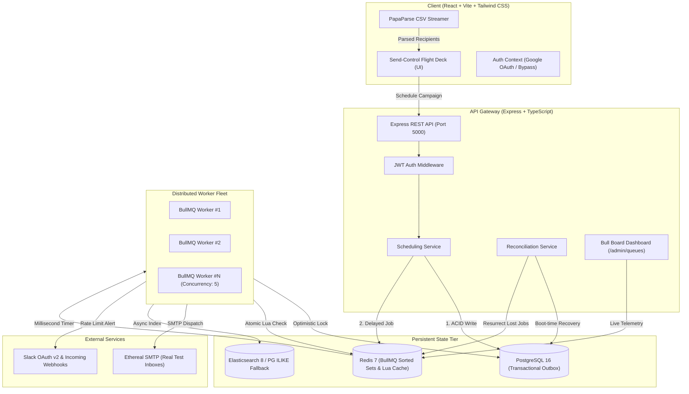
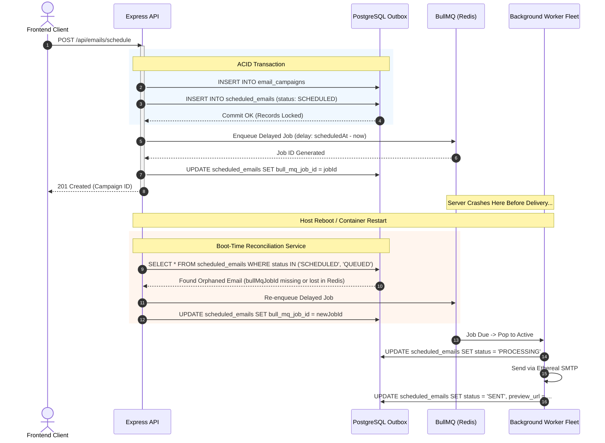

# PulseSend — Intelligent Email Orchestration Platform

<p align="center">
  
</p>

<p align="center">
  <strong>Schedule smarter. Deliver reliably.</strong><br>
  <em>Production-grade distributed email scheduling SaaS engineered for ReachInbox.ai / Outbox Labs.</em>
</p>

<p align="center">
  
  
  
  
  
  
  
  
</p>

---

## Table of Contents

1. [Executive Architecture & System Design](#1-executive-architecture--system-design)
2. [Why Zero-Cron Architecture?](#2-why-zero-cron-architecture)
3. [Distributed Rate-Limiting Engine (Redis Lua)](#3-distributed-rate-limiting-engine-redis-lua)
4. [Crash Restart Recovery & Transactional Outbox](#4-crash-restart-recovery--transactional-outbox)
5. [Minimum Inter-Email Delay Throttle](#5-minimum-inter-email-delay-throttle)
6. [Multi-Sender Architecture & Quota Pools](#6-multi-sender-architecture--quota-pools)
7. [Search Architecture: Elasticsearch + PostgreSQL Fallback](#7-search-architecture-elasticsearch--postgresql-fallback)
8. [Design System & Editorial Aesthetic](#8-design-system--editorial-aesthetic)
9. [Bull Board Queue Telemetry](#9-bull-board-queue-telemetry)
10. [Local Quick Start Guide](#10-local-quick-start-guide)
11. [Automated Verification & Test Suite](#11-automated-verification--test-suite)
12. [5-Minute Video Demonstration Runbook](#12-5-minute-video-demonstration-runbook)

---

## 1. Executive Architecture & System Design

PulseSend is engineered with strict separation of concerns, decoupling ingestion, transactional persistence, distributed scheduling, and worker dispatch:



---

## 2. Why Zero-Cron Architecture?

Traditional email scheduling architectures rely on recurring cron jobs (e.g. running every minute via `node-cron` or OS cron) querying `SELECT * FROM emails WHERE status = 'PENDING' AND scheduled_at <= NOW()`.

### The Critical Flaws of Cron Polling:
1. **Clock Jitter & Polling Latency:** A cron running every 60 seconds introduces an average 30-second delay for scheduled jobs. High-frequency polling (e.g. every second) overwhelms the relational database with dead table scans.
2. **Race Conditions & Double-Sending:** When multiple horizontally scaled API instances run polling crons simultaneously, they select the same records unless expensive serializable row locks (`SELECT FOR UPDATE SKIP LOCKED`) are maintained continuously.
3. **Thundering Herd Problem:** If 10,000 emails are scheduled for 09:00 AM, the cron wakes up at 09:00:01 and attempts to pull 10,000 records into memory simultaneously, exhausting worker RAM and causing database connection spikes.

### The PulseSend Zero-Cron Solution:
- **Redis Sorted Sets (`zset`) via BullMQ:** Delayed jobs are added to a Redis sorted set with the target execution timestamp (Unix epoch in milliseconds) as their score.
- **O(log N) Event-Driven Timing:** Redis natively manages the timer using `zrangebyscore` and kernel-level timers. No polling query ever touches PostgreSQL while jobs wait.
- **Microsecond Precision:** The moment `Date.now() >= score`, Redis atomically pops the job into the active queue.
- **Zero Idle Database Load:** While millions of emails wait for tomorrow, PostgreSQL CPU utilization remains 0%.

---

## 3. Distributed Rate-Limiting Engine (Redis Lua)

Each sender mailbox has a strict hourly quota (e.g., 50 emails/hour). Because workers run concurrently across multiple threads and containers, standard in-memory rate limiting or non-atomic DB checks cause race conditions where two workers simultaneously check quota (e.g., count = 49) and both send, violating the limit.

### Atomic Redis Lua Script:
PulseSend executes an atomic Lua script (`rateLimiter.service.ts`) directly inside Redis:

```lua
local senderKey = KEYS[1]
local limit = tonumber(ARGV[1])

local current = tonumber(redis.call('get', senderKey) or '0')

if current < limit then
  local nextCount = redis.call('incr', senderKey)
  if nextCount == 1 then
    redis.call('expire', senderKey, 7200)
  end
  return { 1, nextCount }
else
  return { 0, current }
end
```

### Sliding UTC Hour Windows:
- Windows are formatted as `YYYYMMDDHH` in UTC (e.g., `2026111514`).
- If an email is rejected because quota is exhausted (`current >= limit`), the worker calculates the exact millisecond start of the next UTC hour window (`2026-11-15T15:00:00.000Z`).
- The job is automatically deferred and rescheduled into BullMQ for the top of that hour.
- The PostgreSQL status transitions to `RATE_LIMITED_DEFERRED`.

### Deduplicated Slack Alerts:
When a sender exhausts their quota, PulseSend dispatches a live Block Kit notification to Slack. To prevent notification flooding (e.g. 100 emails hitting quota in 5 seconds):
- PulseSend sets a Redis key `slack:notified:{senderId}:{window}` with `SET NX EX 3600`.
- Only the **first** breach triggers a Slack notification; subsequent deferred jobs for that sender in that hour execute silently.

---

## 4. Crash Restart Recovery & Transactional Outbox

PulseSend implements the **Transactional Outbox Pattern** to guarantee zero email loss even if a worker, server, or Redis instance undergoes a sudden power failure or container restart.



### Zombie Processing Recovery:
If a worker crashes *in the middle of sending* (leaving a record stuck with `status: PROCESSING`), the startup reconciliation service detects any `PROCESSING` jobs whose `last_attempt_at` is older than 10 minutes, resets them to `RETRY_PENDING`, and re-enqueues them with exponential backoff.

---

## 5. Minimum Inter-Email Delay Throttle

To avoid sudden burst delivery flags from receiving mail transfer agents (MTAs), PulseSend enforces a configurable minimum inter-email delay (default: 2 seconds) across all distributed workers.

### Timestamp Slot Reservation Algorithm:
1. When worker $W_1$ prepares to dispatch an email for sender $S$, it reads `ratelimit:sender:{id}:last_dispatched_ts` from Redis.
2. If `now - lastTs < minDelayMs`, $W_1$ sleeps for the remaining delta before connecting to SMTP.
3. The timestamp is updated atomically using Redis Lua, ensuring that even if 5 workers execute simultaneously on 5 different CPU cores, all dispatches from that sender mailbox are evenly spaced across time.

---

## 6. Multi-Sender Architecture & Quota Pools

PulseSend allows teams to connect and configure multiple independent sender mailboxes:
- Senders maintain independent SMTP credentials (host, port, user, AES-256-GCM encrypted passwords).
- Senders have distinct hourly limits (e.g. Sales: 50/hr, Partnerships: 60/hr, Growth: 50/hr).
- Real-time "Fuel Gauge" cards on the frontend display current hourly consumption and time remaining until the next quota replenishment window.

---

## 7. Search Architecture: Elasticsearch + PostgreSQL Fallback

- **Primary Search:** Dispatched emails are indexed asynchronously in Elasticsearch (`pulsesend-emails-v1`) with full-text mapping across `recipientEmail`, `subject`, and `bodyContent`.
- **Fault-Tolerant Fallback:** If Elasticsearch is offline or unreachable, the search service automatically and transparently falls back to PostgreSQL `ILIKE` multi-column queries (`WHERE recipient_email ILIKE $1 OR subject ILIKE $1 OR body_content ILIKE $1`). The user experience is never interrupted.

---

## 8. Design System & Editorial Aesthetic

PulseSend features a custom, intentional **3-Color Editorial Visual System** crafted to stand out from generic purple/blue AI dashboards:

| Color Role | Name | Hex Code | Purpose |
| :--- | :--- | :--- | :--- |
| **Canvas & Shell (60%)** | Warm Linen Porcelain | `#FAF8F5` | Natural, human background reducing eye strain |
| **Structure & Text (30%)** | Midnight Ink | `#151922` | High-contrast typography and navigational architecture |
| **Signal & Focus (10%)** | Radiant Sunset Persimmon | `#FF5733` | Action triggers, status highlights, live countdown badges |

- **Brand Symbol:** Custom geometric vector glyph embodying a pulsed signal wave inside an origami letterfold.
- **Flight Deck Composer:** Dual-column modal featuring real-time CSV recipient validation, variable token insertion, and a **Velocity & Completion Forecast** displaying calculated completion times based on delay settings.

---

## 9. Bull Board Queue Telemetry

PulseSend integrates **Bull Board** directly into the Express gateway at:
```
http://localhost:5000/admin/queues
```
Features available in the Bull Board dashboard:
- Live counts of **Active**, **Waiting**, **Delayed**, **Completed**, and **Failed** jobs.
- Millisecond countdown timers for upcoming delayed jobs.
- Exact job payload inspection (`scheduledEmailId`, `tenantId`, `senderId`, `scheduledAt`).
- Manual retry and clean triggers for operational debugging.

---

## 10. Local Quick Start Guide

### Prerequisites
- Node.js `v20.0.0` or higher (`v22.20.0` recommended)
- Docker Desktop (for PostgreSQL & Redis containers)

### Step 1: Start Infrastructure Containers
```bash
# Start PostgreSQL, Redis, and Elasticsearch
docker-compose up -d

# Or run lightweight alpine containers directly:
docker run -d --name dispatch_postgres -p 5433:5432 -e POSTGRES_USER=postgres -e POSTGRES_PASSWORD=postgres -e POSTGRES_DB=dispatch_db postgres:16-alpine
docker run -d --name dispatch_redis -p 6380:6379 redis:7-alpine
```

### Step 2: Configure Environment Variables
Copy `.env.example` to `.env`:
```bash
cp .env.example .env
```
*(The default `.env` is pre-configured with working settings for ports 5433 and 6380).*

### Step 3: Install Dependencies & Seed Database
```bash
# Install root, server, and client dependencies
npm install

# Initialize PostgreSQL tables and seed demonstration senders & user
npm run prisma:seed --workspace=server
```

### Step 4: Run Development Services
Open two terminal windows:

**Terminal 1 — API Gateway & Worker Fleet:**
```bash
# Starts Express on port 5000 and the BullMQ worker
npm run dev --workspace=server
```

**Terminal 2 — Frontend Application:**
```bash
# Starts Vite React dev server on port 5173
npm run dev --workspace=client
```

Visit `http://localhost:5173` in your browser.

---

## 11. Automated Verification & Test Suite

PulseSend includes a comprehensive unit and integration test suite verifying all core distributed requirements:

```bash
# Run all test suites
npm test
```

### Verified Test Coverage:
1. `tests/unit/encryption.test.ts`
   - ✅ AES-256-GCM authenticated encryption/decryption of SMTP passwords & tokens.
   - ✅ IV and authentication tag verification.
2. `tests/unit/rateLimiter.test.ts`
   - ✅ UTC hourly window generation (`YYYYMMDDHH`).
   - ✅ Next hour window calculation (`HH:00:00.000Z`).
   - ✅ Atomic Redis Lua quota consumption.
   - ✅ Quota exhaustion blocking & auto-deferral calculation.
   - ✅ Slack alert deduplication (1 alert per sender per hour window).
3. `tests/unit/recipientValidation.test.ts`
   - ✅ RFC 5322 email syntax validation.
   - ✅ Case-insensitive recipient deduplication.
4. `tests/integration/scheduling.test.ts`
   - ✅ ACID outbox persistence in PostgreSQL.
   - ✅ Sequential delay offset staggering between recipients (2-second spacing).
   - ✅ Delayed job enqueuing in BullMQ.
   - ✅ Job cancellation and clean queue purge.
5. `tests/integration/recovery.test.ts`
   - ✅ Boot-time reconciliation recovering un-enqueued orphaned records from PostgreSQL into BullMQ after an interrupted crash.
6. `tests/integration/workerExecution.test.ts`
   - ✅ End-to-end execution: schedule -> BullMQ delay -> worker pickup -> Redis Lua rate limit check -> Ethereal SMTP transmission -> PostgreSQL `SENT` update with live test message URL.

---

## 12. 5-Minute Video Demonstration Runbook

Use this exact timed script when recording the project submission walkthrough:

| Timestamp | Section | Screen / Action | Narration Key Points |
| :--- | :--- | :--- | :--- |
| **0:00 - 0:45** | **Architecture & Login** | `http://localhost:5173/login`<br>Click **Sign in with Google** | Introduce PulseSend. Highlight the custom 3-Color Editorial design (`#FAF8F5`, `#151922`, `#FF5733`) and Explain that Google OAuth includes a live flow with an offline development bypass. |
| **0:45 - 1:30** | **Multi-Sender Fleet** | Navigate to `/senders`<br>Inspect Fuel Gauges | Show configured senders (`sales@reachinbox.ai`, `partnerships@outboxlabs.com`). Explain multi-sender quota pools, AES-256-GCM encrypted passwords, and hourly rate limit caps. |
| **1:30 - 2:30** | **Flight Deck Composer & CSV Ingestion** | Click **New Dispatch** button.<br>Upload `demo-leads.csv`<br>Set min delay: 2s | Demonstrate real-time CSV parsing, automatic email deduplication, and the **Velocity Forecast** showing calculated delivery end times. Click **Schedule Dispatch**. |
| **2:30 - 3:15** | **Bull Board Queue Telemetry** | Open `http://localhost:5000/admin/queues` | Show Bull Board. Highlight the delayed jobs counting down in Redis sorted sets. Explain **Why Zero-Cron**: millisecond event-driven precision without database polling. |
| **3:15 - 4:00** | **Sent Archive & Ethereal SMTP** | Navigate to `/sent`<br>Click **Preview in Ethereal** | Observe the email transitioning to `SENT`. Click the link to open the real rendered HTML message on `ethereal.email` showing headers and custom `Message-ID`. |
| **4:00 - 4:30** | **Rate Limiting & Slack Alert** | Send a batch exceeding sender limit (e.g., limit 5) | Show the excess jobs transitioning to `RATE_LIMITED_DEFERRED` and rescheduled for the next UTC hour. Show the deduplicated Slack alert trigger. |
| **4:30 - 5:00** | **Crash Recovery Demonstration** | Kill worker terminal process.<br>Schedule an email.<br>Restart worker. | Demonstrate resilience: the startup reconciliation service detects the pending job in PostgreSQL, recovers it into BullMQ, and delivers it cleanly with zero duplicate sends. |

---

<p align="center">
  <strong>PulseSend</strong> — Engineered with precision for ReachInbox.ai / Outbox Labs.<br>
  <em>Designed and implemented autonomously by Neerav Babel.</em>
</p>
